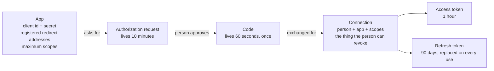

# 1. Concepts

[← Overview](README.md) · Next: [Connecting a person →](02-connecting-a-person.md)

This page defines the words used everywhere else. Five minutes here saves a lot of confusion later.

## The parties

| Party                   | Who it is                                                                                                                                                             |
| ----------------------- | --------------------------------------------------------------------------------------------------------------------------------------------------------------------- |
| **Person**              | A human with a Plane account — here, an employee. They are the only one who can approve a connection and the only one it ever acts for.                               |
| **App** (also _client_) | Your program: the bot server. It is registered once in Plane by whoever runs the server, and proves who it is with a client secret.                                   |
| **Plane**               | The server. It decides what the app may see; the app cannot widen that.                                                                                               |
| **Chat account**        | The person's identity on the app's side (a Telegram user, say). Plane records _which_ chat account was linked, so the person can recognise it, but never talks to it. |

## The objects

- **App** — registered by an administrator ([how](05-operations.md#registering-an-app)). Has a public `client_id`, a secret, a list of **exact** addresses it may send people back to, and the **most** scopes it may ever ask for.
- **Authorization request** — your app's statement of "I want to be linked to _this_ chat account, for _these_ scopes, and send the person back _here_". Registered from your server, so nothing the person's browser carries can be altered on the way.
- **Code** — what the approval produces. Useless without the secret verifier your app made for that one request (PKCE), and valid once, for 60 seconds.
- **Connection** — one person's yes to one app for a set of scopes. It appears under _Profile → Connected apps_ and is the unit of revocation: ending it ends every token under it at once.
- **Access token** — what you put in `Authorization: Bearer`. Short-lived.
- **Refresh token** — what you swap for a new pair. Valid once.

A person can have several connections to the same app (for example two Telegram accounts); each is separate and separately revocable.

## Lifetimes

| What                         | Lasts                           | Why this long                                                                                                                                                                   |
| ---------------------------- | ------------------------------- | ------------------------------------------------------------------------------------------------------------------------------------------------------------------------------- |
| The link given to the person | **10 minutes**                  | Long enough to find a phone and sign in; a link left in a chat history is dead by the time anybody finds it.                                                                    |
| The code from an approval    | **60 seconds**, once            | Your server is waiting on the redirect.                                                                                                                                         |
| Access token                 | **1 hour**                      | A leaked token stops working soon without anyone doing anything.                                                                                                                |
| Refresh token                | **90 days**, replaced every use | An app that calls at least every three months never needs the person again.                                                                                                     |
| Connection (absolute limit)  | **365 days**                    | However busy the app is, the person agrees again once a year.                                                                                                                   |
| Retry window for a refresh   | **10 seconds**                  | Two calls with the same refresh token this close together are one app retrying; further apart means the token was copied (see [refresh](02-connecting-a-person.md#refreshing)). |

The server's administrator can change these ([settings](05-operations.md#settings)); the defaults are meant to be left alone.

## Scopes

A scope is a promise made on the approval screen. Each is narrow and named for what it lets the app _see_.

| Scope              | The person is told                                                                                                                                           | Unlocks                                                                                                                  |
| ------------------ | ------------------------------------------------------------------------------------------------------------------------------------------------------------ | ------------------------------------------------------------------------------------------------------------------------ |
| `profile`          | "Your name, your time zone and the workspaces you belong to."                                                                                                | `GET /me/`                                                                                                               |
| `time:read`        | "Whether each day is a working day, a public holiday or a day off for you, the hours you have worked, and the work item your timer is running on."           | `GET /me/day/`, `/me/days/`, `/me/time/`, `/me/timer/`                                                                   |
| `leave:read`       | "Your leave balance, and the kind of absence (for example holiday or sick leave) booked on a day off."                                                       | `GET /me/leave/`, `/me/absences/`; adds the absence _type_ to day answers                                                |
| `work_items:read`  | "The projects you are a member of and the work items you can see in them, with their comments."                                                              | `GET /projects/`, `/work-items/`, `/workspaces/{slug}/work-items/{ref}/`; adds work item names to time and timer answers |
| `work_items:write` | "Create work items, change their state, priority, dates, assignees and labels, and add comments, as you. Everything it does shows in Plane under your name." | Creating and changing work items, comments and attachments. **Can make changes.**                                        |
| `time:write`       | "Start and stop your timer, and add hours to your time, as you."                                                                                             | `POST /me/timer/start/`, `/me/timer/stop/`, `/me/time-entries/`. **Can make changes.**                                   |

How scopes combine:

- **Ask only for what you use.** People read the list. A bot that only needs to know whether today is a working day should ask for `profile time:read` and nothing else.
- **Some answers get richer with more scopes**, and are deliberately plain without them. Example: with only `time:read`, a day off is reported as `{"kind": "absence"}` — enough to know not to ask for a report. With `leave:read` as well, the answer also says it is sick leave or annual leave. The reason for a sick day is health information; do not ask for it unless you must.
- **Scopes cannot be added to an existing connection.** To get more, run the link flow again; the person sees and approves the new list.
- **An app can only request scopes it was registered with.** Registration is the ceiling. An app registered without naming scopes gets the **read-only** ones; being allowed to change people's work is an explicit decision by the administrator ([how](05-operations.md#registering-an-app)).
- **Write scopes are shown differently.** The approval screen marks them "Can make changes". Ask for them only when the person has asked your bot to do something, and say what it will do.

## What a token is, and is not

A token **is** the person, restricted to its scopes and to the Agent API. With only read scopes it can only read; with a write scope it can make exactly the changes that scope names, as the person, under the same rules the web app applies to them.

A token is **not**:

- a browser session — it cannot open Plane's web app or call any of its internal endpoints;
- an API key — it is refused by the public `/api/v1/` API;
- an administrator — it can never do more than the person can, and never reaches data the person cannot see.

Because access is decided **on every request** (not when the token was issued), these take effect on the very next call:

- the person ends the connection, or the administrator ends it, or switches the app off;
- the person is deactivated in Plane;
- the person is removed from a project or workspace;
- a refresh token is replayed.

## Whose data, and what is left out

Everything returned is the **connected person's own** working data or work they can see in Plane. There is no way to ask about another person with these scopes.

Deliberately never returned, at any scope:

- the free-text **reason** on an absence, and rejection reasons;
- medical certificates or any attached documents;
- the person's email address (the app identifies them by the Plane `id`, and by the chat account it linked).

Deliberately returned only with the matching scope:

- the **type** of an absence — `leave:read`;
- the **names** of work items behind hours and timers — `work_items:read`.

## Time and dates

- **Dates** are `YYYY-MM-DD`; **timestamps** are ISO 8601 with an offset (`2026-03-04T08:05:00+00:00`).
- **"Today", and which day an hour belongs to, are decided in the person's own working time zone** (their employment record's zone, else the workspace's). Every answer that depends on it says which zone it used in `timezone`. Never infer "today" from your server's clock.
- **Durations** are whole **minutes** in integer fields named `…_minutes`. Hours worked are summed per day per project and rounded once, the same way Plane's monthly figures are, so what you report agrees with what the person sees in _My time_.

## Auditing

Every call made with a token is written to an audit log: when, which connection, method, path, status code and the caller's address. **Never** the query string, the request or the response — the log records that something happened, not what was in it. Linking, refreshing and revoking are logged too, and a refresh-token replay is logged as such. Entries are kept for 180 days by default. See [Operations](05-operations.md#the-audit-log).

---

[← Overview](README.md) · Next: [Connecting a person →](02-connecting-a-person.md)
