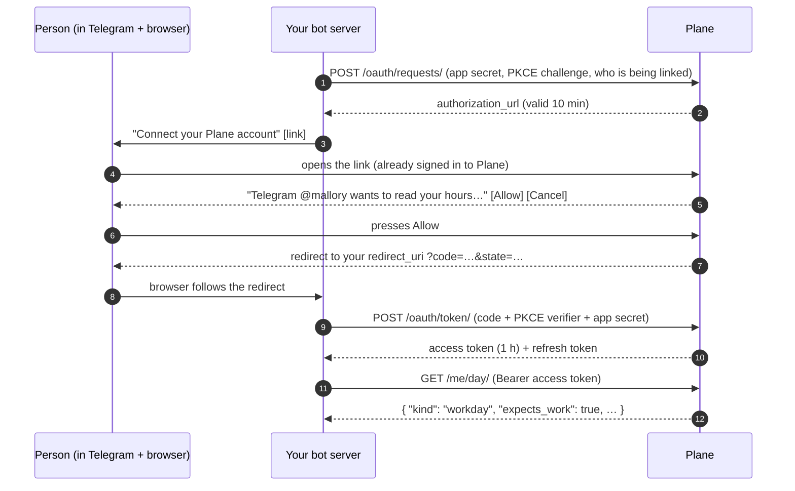

# Plane Agent API

The Agent API lets an application you run — a chat bot, a scheduled assistant, an AI agent — act **on behalf of one person** in Plane: read their working days, hours, timer, leave, projects and work items, with that person's explicit consent and nothing more.

It was designed for a Telegram bot that talks to each employee, but nothing in it is specific to Telegram. Any server-side application can use it.

> **Status — version 1: reading and acting.** An app can read a person's days, hours, leave, projects and work items, and — only with the extra scopes the person approves — create and change work items, comment, attach files, and start and stop their timer or add hours. A manager's app can also read how their team is doing (days, hours, open work), with a scope of its own that is never a default. Plane can also **tell the app when something happens** (assigned, due date or state changed, connection ended) instead of the app asking. Apps that do not use these are unaffected. See [Roadmap](#roadmap).

---

## How it works, in one picture



The person signs in to Plane in their own browser, exactly as they always do. **Your bot never sees their password**, and the link can be taken back by the person at any time from _Profile → Connected apps_.

---

## Read this first

| If you are…                                          | Start with                                                                                                                                     |
| ---------------------------------------------------- | ---------------------------------------------------------------------------------------------------------------------------------------------- |
| Building the bot                                     | [Quick start](#quick-start-in-ten-minutes), then [Connecting a person](02-connecting-a-person.md) and the [API reference](03-api-reference.md) |
| Building it for Telegram                             | [Telegram bot recipe](06-telegram-recipe.md)                                                                                                   |
| Responsible for what the bot does with people's data | [Security guide for app developers](04-security-guide.md) — **mandatory reading**                                                              |
| Running the Plane server                             | [Operations guide](05-operations.md)                                                                                                           |
| Wanting to be told when work changes                 | [Events](07-events.md)                                                                                                                         |
| Generating a client or importing into Postman        | [`openapi.yaml`](openapi.yaml)                                                                                                                 |

### The documents

| #   | Document                                         | What it covers                                                                                  |
| --- | ------------------------------------------------ | ----------------------------------------------------------------------------------------------- |
| 1   | [Concepts](01-concepts.md)                       | Apps, connections, scopes, tokens, lifetimes, what a token can and cannot do                    |
| 2   | [Connecting a person](02-connecting-a-person.md) | The complete link flow, PKCE, refresh, revocation, every error                                  |
| 3   | [API reference](03-api-reference.md)             | Conventions and every endpoint, with parameters and real example responses                      |
| 4   | [Security guide](04-security-guide.md)           | What the app developer is obliged to do — secrets, prompt injection, group chats, personal data |
| 5   | [Operations guide](05-operations.md)             | Registering apps, settings, audit log, revoking, troubleshooting                                |
| 6   | [Telegram bot recipe](06-telegram-recipe.md)     | A worked design for a daily check-in bot                                                        |
| 7   | [Events](07-events.md)                           | Being told when something happens: setup, signature, retries, the events                        |
| —   | [Sandbox bot](examples/README.md)                | A runnable stand-in for the bot, to try everything before the real one exists                   |
| —   | [`openapi.yaml`](openapi.yaml)                   | Machine-readable OpenAPI 3.1 description                                                        |

---

## Quick start in ten minutes

You need: a Plane server (with this feature deployed), a person with a Plane account to test with, and a public HTTPS address for your bot's callback (or `http://localhost:<port>` while developing).

Replace `PLANE` with your Plane address, for example `https://plane.example.com`.

> **No bot yet?** [`examples/sandbox_bot.py`](examples/README.md) does all of this with a web page: it links you, calls every endpoint, previews and creates a work item, and shows Plane's events. It is also the shortest working example of the flow below.

### 1. Get your app registered

Someone who runs the Plane server registers your app once, on the _Connected apps_ page of the admin app or with the command ([how](05-operations.md#registering-an-app)):

```bash
python manage.py agent_client create \
    --name "Check-in bot" \
    --redirect-uri https://bot.example.com/plane/callback
```

They give you a **client id** (`plane_client_…`) and a **client secret** (`plane_cs_…`). The secret is shown once and cannot be recovered; keep it in your secret store, never in code or chat.

### 2. Ask for a link

Make a random _code verifier_ and its _challenge_ (PKCE), then register the request from your **server**:

```bash
VERIFIER=$(openssl rand -base64 48 | tr '+/' '-_' | tr -d '=\n')
CHALLENGE=$(printf %s "$VERIFIER" | openssl dgst -sha256 -binary | openssl base64 | tr '+/' '-_' | tr -d '=\n')

curl -sS -X POST "$PLANE/api/agent/v1/oauth/requests/" \
  -u "$CLIENT_ID:$CLIENT_SECRET" \
  -H "Content-Type: application/json" \
  -d '{
    "redirect_uri": "https://bot.example.com/plane/callback",
    "scope": "profile time:read work_items:read",
    "state": "a-random-value-you-keep",
    "code_challenge": "'"$CHALLENGE"'",
    "code_challenge_method": "S256",
    "account_provider": "telegram",
    "account_id": "424242",
    "account_username": "mallory",
    "account_name": "Mallory Test"
  }'
```

```json
{
  "authorization_url": "https://plane.example.com/connect/agent/plane_ar_…",
  "expires_in": 600
}
```

Send `authorization_url` to the person. Keep `VERIFIER` and `state` — you need them in step 4.

### 3. The person says yes

They open the link, check who is asking and what for, and press **Allow**. Their browser is redirected to:

```
https://bot.example.com/plane/callback?code=plane_ac_…&state=a-random-value-you-keep
```

If they press **Cancel** it is `?error=access_denied&state=…` instead.

### 4. Exchange the code for tokens

Within 60 seconds, from your server:

```bash
curl -sS -X POST "$PLANE/api/agent/v1/oauth/token/" \
  -u "$CLIENT_ID:$CLIENT_SECRET" \
  -d grant_type=authorization_code \
  -d code="$CODE" \
  -d redirect_uri="https://bot.example.com/plane/callback" \
  -d code_verifier="$VERIFIER"
```

```json
{
  "access_token": "plane_at_…",
  "token_type": "Bearer",
  "expires_in": 3600,
  "refresh_token": "plane_rt_…",
  "scope": "profile time:read work_items:read"
}
```

Store **both** tokens, encrypted, against that person. Never log them.

### 5. Call the API

```bash
curl -sS "$PLANE/api/agent/v1/me/day/" -H "Authorization: Bearer $ACCESS_TOKEN"
```

```json
{
  "employed": true,
  "timezone": "Europe/Vienna",
  "today": "2026-03-04",
  "day": {
    "date": "2026-03-04",
    "weekday": "wednesday",
    "kind": "workday",
    "expects_work": true,
    "scheduled_minutes": 480,
    "expected_minutes": 480,
    "has_schedule": true,
    "holiday": null,
    "absences": [],
    "worked_minutes": 0,
    "is_today": true,
    "timer_running": false
  }
}
```

`expects_work` is the field your morning job needs: **`false` on a public holiday, a weekend or an approved day off — do not ask for a daily plan.**

### 6. Keep the connection alive

The access token lasts one hour. Before it ends, swap the refresh token for a new pair — **the old refresh token stops working the moment you use it**:

```bash
curl -sS -X POST "$PLANE/api/agent/v1/oauth/token/" \
  -u "$CLIENT_ID:$CLIENT_SECRET" \
  -d grant_type=refresh_token \
  -d refresh_token="$REFRESH_TOKEN"
```

Save the new refresh token **before** you use the new access token. If you ever get `invalid_grant`, the connection is over (revoked, expired or replayed): ask the person to connect again.

---

## What the API offers (version 1)

| Question your bot has                                        | Endpoint                                                                  | Scope                                       |
| ------------------------------------------------------------ | ------------------------------------------------------------------------- | ------------------------------------------- |
| Who is this, and which workspaces are they in?               | `GET /me/`                                                                | `profile`                                   |
| Is today a working day for them?                             | `GET /me/day/`                                                            | `time:read`                                 |
| Which of the next days are working days, holidays, days off? | `GET /me/days/`                                                           | `time:read`                                 |
| How much have they worked, and on what?                      | `GET /me/time/`                                                           | `time:read` (+ `work_items:read` for names) |
| What is their timer running on right now?                    | `GET /me/timer/`                                                          | `time:read` (+ `work_items:read`)           |
| How much leave do they have left?                            | `GET /me/leave/`                                                          | `leave:read`                                |
| What leave is booked?                                        | `GET /me/absences/`                                                       | `leave:read`                                |
| Which projects are they in (an admin: every project)?        | `GET /projects/`                                                          | `work_items:read`                           |
| What are they assigned to, what is due?                      | `GET /work-items/`                                                        | `work_items:read`                           |
| What does this task say, what was discussed?                 | `GET /workspaces/{slug}/work-items/{ref}/`                                | `work_items:read`                           |
| Who can I assign to, which states and labels exist?          | `GET /workspaces/{slug}/projects/{id}/members/`, `…/states/`, `…/labels/` | `work_items:read`                           |

**Acting for the person** (each needs its own scope, shown to the person as "can make changes"):

| What the person asked the bot to do               | Endpoint                                                | Scope              |
| ------------------------------------------------- | ------------------------------------------------------- | ------------------ |
| Create a task (with description, assignee, dates) | `POST /workspaces/{slug}/projects/{id}/work-items/`     | `work_items:write` |
| Move it, re-prioritise it, assign or unassign     | `PATCH /workspaces/{slug}/work-items/{ref}/`            | `work_items:write` |
| Add to its description, or replace it             | `PATCH /workspaces/{slug}/work-items/{ref}/`            | `work_items:write` |
| Add a comment                                     | `POST /workspaces/{slug}/work-items/{ref}/comments/`    | `work_items:write` |
| Attach a file the person sent                     | `POST /workspaces/{slug}/work-items/{ref}/attachments/` | `work_items:write` |
| Start or stop their timer                         | `POST /me/timer/start/`, `POST /me/timer/stop/`         | `time:write`       |
| Add hours they worked                             | `POST /me/time-entries/`                                | `time:write`       |

**For managers** (scope `team:read`, which only works while the person is a manager in Plane):

| What the manager asks the bot              | Endpoint                          | Scope                           |
| ------------------------------------------ | --------------------------------- | ------------------------------- |
| Who is on my team?                         | `GET /team/`                      | `team:read`                     |
| Who has room next week, who is overloaded? | `GET /team/workload/`             | `team:read`                     |
| What is on Ana's plate?                    | `GET /team/{user_id}/work-items/` | `team:read` + `work_items:read` |

A colleague's day off is reported as _away_, never why, and only the work the manager can see themselves is counted. See [Your team](03-api-reference.md#your-team-managers) and [Security guide §4b](04-security-guide.md#4b-managers-reading-about-colleagues).

Every change is made **as the person**, with the same rules as in the web app, and appears in Plane under their name. Creating and attaching need an `Idempotency-Key`, and creating or changing can be previewed with `?dry_run=true` so the bot can ask "create this?" before it does. See [Making changes](03-api-reference.md#making-changes).

**Being told** (an address the administrator sets for your app): `work_item.assigned`, `work_item.unassigned`, `work_item.due_date_changed`, `work_item.state_changed` and `connection.revoked`, each a signed request carrying ids only. See [Events](07-events.md).

Full detail in the [API reference](03-api-reference.md).

---

## Principles the API is built on

These explain the shape of everything else.

- **It is the person, not the app.** A token acts as the person who approved it and sees exactly what they see in Plane — no more. Taking them out of a project removes it from the bot's view on its next call.
- **Consent is specific and visible.** Each capability is a _scope_, listed on the approval screen in plain words. Nothing is granted that was not shown.
- **The person stays in control.** They see every connected app, when it last called, and can end the connection in one click.
- **Data minimisation by design.** Whether somebody is away today is working-day information; _why_ is not, and is a separate scope. Free-text reasons and notes are never returned.
- **Everything is a hash at rest.** Plane stores only hashes of secrets and tokens; a copy of the database contains nothing that can be used.
- **Plane stays the source of truth.** Working-day logic, holidays and leave arithmetic are computed by Plane, the same way the monthly figures are. Your bot does not re-implement them.

---

## Roadmap

Not available yet (planned, in this order):

1. **More ways to change work**: linking work items, moving work between projects. (A description can be added to or replaced, with safeguards: see [Editing the description](03-api-reference.md#editing-the-description).)

If you need one of these sooner, say which; the design leaves room for each.

---

## Support and source

- Code: `apps/api/plane/agent/` (models, OAuth flow, endpoints), tests in `apps/api/plane/tests/contract/agent/`.
- Web screens: the consent page at `/connect/agent/<link>` and _Profile → Connected apps_.
- This documentation lives in `docs/agent-api/`; if something here and the behaviour disagree, that is a bug — please report it with the request and response.
